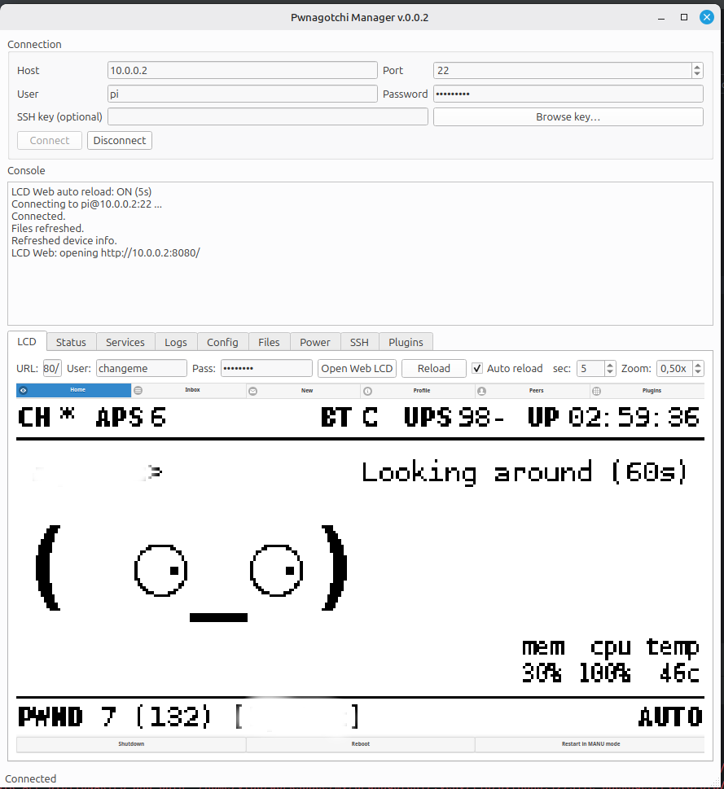

# qPwnagotchi — Pwnagotchi Manager

A small PyQt6 desktop app to manage **your own** Pwnagotchi over SSH.



This project intentionally does **not** provide features for offensive actions.
It is a remote-admin convenience tool for a device you already own.

## Features

- **Dashboard** — native cards: name/face, mode, epoch/reward, handshakes, peers, uptime, CPU temp, load, memory, disk, IP, battery (REST API + SSH probe).
- **Service control**, **Details** (raw `uname`/`df`/`ip`), **Logs** and a **Live log** viewer (follow, level filter, search, pause).
- **Config editor** — TOML syntax check, diff before save, automatic on-device backup, backups browser with one-click restore.
- **Plugins** — searchable catalog (version, status, update badges, filters); toggle `enabled` (comment/format preserving); install / update / upgrade via the on-device CLI.
- **History** — charts of temperature, battery, memory, load, handshakes and epoch per device (SQLite, 30 days), availability %, CSV export.
- **Themes** — light, dark or follow-system (View → Theme).
- **Handshakes** — list, download, delete captures (no cracking or attack features).
- **Files** — SFTP manager with drag & drop, overwrite prompt, cancellable transfers.
- **Terminal** — real PTY shell (colours, `top`/`nano`, resize, copy/paste) + a quick one-command box.
- **Fleet** — poll many devices, bulk actions, CSV export, offline/handshake notifications.
- **LCD** preview of the on-device web UI (per-profile zoom/reload, self-signed cert trust).
- **Profiles** — saved connections, keyring password storage, connect-on-launch, `--profile NAME --connect`.
- **Security** — SSH host-key verification (trust on first use, loud on change).
- **Discovery** of devices (mDNS + USB/Bluetooth-tether addresses), **mode switch** AUTO/MANUAL, reboot/shutdown.

## Architecture

qPwnagotchi is a single-process PyQt6 app. `MainWindow` (`ui_main.py`) owns one
shared `SSHClient` (paramiko; commands + one lazily-created SFTP channel) that
the tabs use through `run_in_thread` (a `QThread` + `Worker`, result delivered
back on the GUI thread). The **Fleet** tab is independent of that session: each
probe/bulk action uses its *own* short-lived `SSHClient` on a `QThreadPool`.

```
app.py                       entry point (--version works headless)
pwnman/pwnman/
  version.py                 single source of truth for the version
  ui_main.py                 main window: menus, connection bar, profiles, session wiring
  details_tab / services_tab / logs_tab / config_tab / plugins_tab / power_tab / lcd_tab / dialogs   one module per tab
  metrics_store.py / metrics_tab.py / chart.py   history database, tab, QPainter line chart
  plugin_catalog.py          Qt-free plugin merge/filter logic
  theme.py                   light/dark/system palettes
  ssh_client.py              paramiko wrapper (exec, SFTP, key/passphrase handling)
  remote_config.py           safe read/write of root-owned files (SFTP + sudo cp + backup)
  plugins_toml.py            Qt-free config.toml plugin parsing/toggling
  session.py                 connection state, watchdog, auto-reconnect
  known_hosts.py             TOFU host-key store/policy
  secrets_store.py           OS keyring backend for passwords
  remote_cmds.py             every remote shell command (quoted + validated)
  config_tools.py            TOML check, diff, config backups
  pty_terminal.py            PTY terminal (pyte emulator + Qt view)
  ssh_terminal.py            "Quick cmd" one-command box (cwd carried across commands)
  dashboard_tab.py / handshakes_tab.py / live_log_tab.py   new tabs
  alerts.py / discovery.py   notification rules, device discovery
  nav_tabs.py                left navigation rail
  fleet.py / fleet_tab.py    multi-device polling (SSH probe + REST /api/v1/session)
  file_manager.py            SFTP browser (drag & drop, recursive transfer/delete)
  export_folder_tab.py       tar.gz a remote folder via sudo
  profile_store.py / profile_dialog.py / models.py   saved connection profiles (0600 JSON)
  resources.py / async_utils.py
tests/                       unit tests (no network) + tests/e2e (needs the fake device)
docker/                      hermetic build + e2e images
packaging/                   .desktop, icons, rpm spec, NSIS installer
scripts/                     build / package / e2e scripts
```

## Running from source

```bash
make venv     # create .venv and install requirements
make run      # launches the GUI
make test     # unit tests (offscreen Qt, no network)
```

Requirements: Python >= 3.10, PyQt6, PyQt6-WebEngine, paramiko.

## Building (everything hermetic, in Docker)

Only Docker (with buildx) is needed; toolchains, Wine and NSIS live in the
images. Artifacts land in `dist/`.

| Command            | Output                                                                 |
| ------------------ | ---------------------------------------------------------------------- |
| `make linux-amd64` | `qpwnagotchi-<v>-amd64`, `qpwnagotchi_<v>_amd64.deb`, `qpwnagotchi-<v>-1.x86_64.rpm` |
| `make linux-arm64` | same for arm64 / aarch64 (uConsole CM4, RPi 4/5) via qemu emulation     |
| `make windows`     | `qpwnagotchi-<v>-windows-x64-setup.exe` (NSIS) + portable `.zip` (Wine) |
| `make dist-all`    | all of the above + `SHA256SUMS`                                         |

**arm64 note:** PyQt6's aarch64 wheels are `manylinux_2_39`, so the arm64 binary/`.deb`/`.rpm` are built on Debian trixie and need glibc ≥ 2.39 (Debian 13, Ubuntu 24.04+, current Raspberry Pi OS). On older systems run from source against the distro's `python3-pyqt6`.

arm64 on an x86 host needs qemu/binfmt registered once:
`docker run --privileged --rm tonistiigi/binfmt --install arm64`.

Host builds (no Docker) remain available: `make build`, `make deb`, `make rpm`.
PyInstaller cannot cross-compile, hence the per-platform containers. The
version comes from `pwnman/pwnman/version.py` (a `vX.Y.Z` git tag wins; untagged
builds get `+git<sha>`); override with `make VERSION=1.2.3 ...`.

Install: `sudo dpkg -i dist/qpwnagotchi_*.deb` / `sudo rpm -i dist/*.rpm` /
run the Windows setup. armhf and riscv64 have no PyQt6 wheels: run from source
against distro `python3-pyqt6`.

## Testing

```bash
make test           # fast unit tests
make e2e            # hermetic end-to-end suite
make e2e-package    # install the built .deb in a clean container and boot the GUI
make lint           # ruff
```

`make e2e` builds a *fake Pwnagotchi* image (sshd, sudo, stub `systemctl` /
`reboot`, `vcgencmd`, a root-owned `config.toml`, plugin dirs, handshakes and a
REST API) and a runner image that drives the **real GUI** (offscreen Qt) over
real SSH/SFTP. They talk over a Docker `--internal` network: no internet, no
published ports. Covers connect/auth (password, key, encrypted key), services,
logs, config save round-trip, plugin toggling, SFTP transfer, export, terminal,
profiles, fleet probing/bulk actions and power.

## Security notes

- Passwords live in the OS keyring when available; otherwise they are stored in plain JSON (`0600`) and the app logs a warning.
- SSH host keys are verified (`known_hosts` in the config dir). A changed key is refused.
- The Web LCD trusts self-signed certificates only per host + SHA-256 fingerprint, after confirmation.

## Cleaning up

```bash
make clean      # removes build/, dist/, __pycache__, .pytest_cache
make distclean  # also removes .venv
```

## License

See repository.
